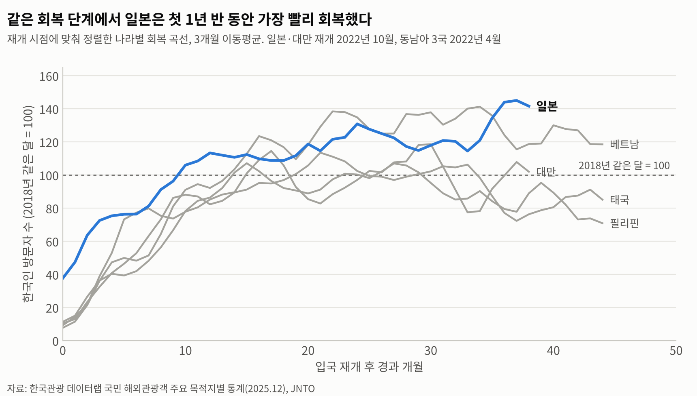
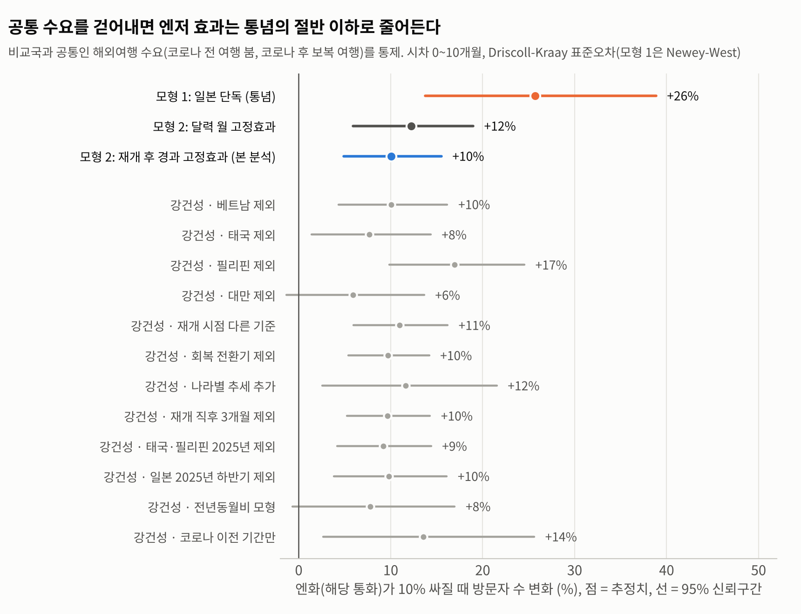
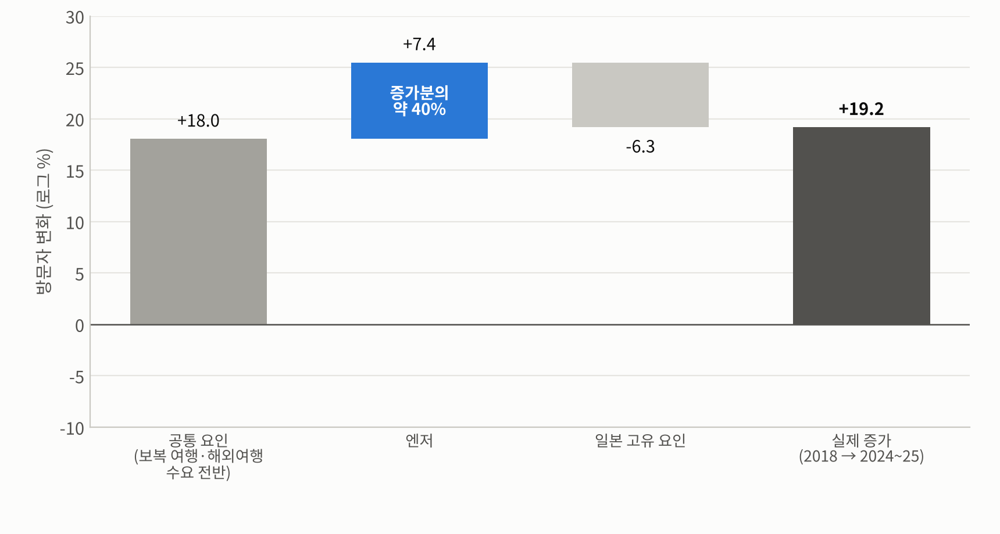
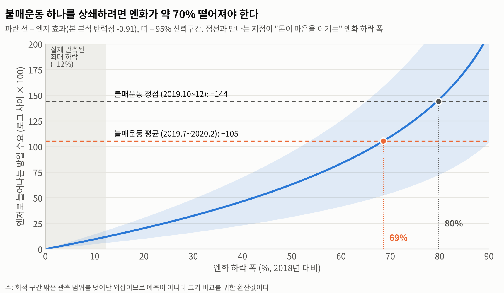
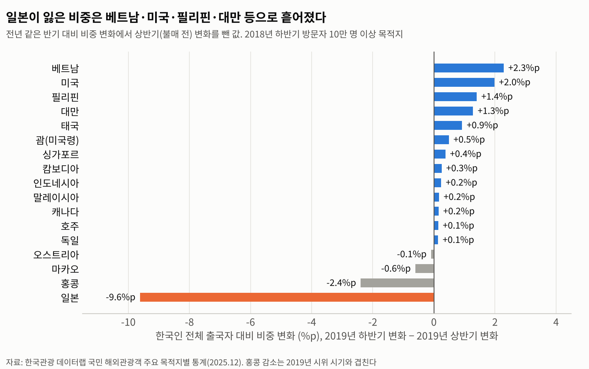
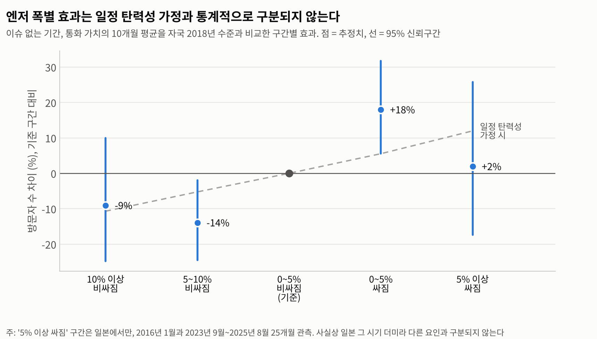

# 일본 여행을 결정하게 되는 것은 돈일까? 마음일까?

**엔저(돈)와 불매운동 같은 사회적 이슈(마음)가 한국인의 일본 여행 수요에 미치는 영향의 크기 비교**

2026 가천대학교 응용통계학과 학술제 출품작의 분석 코드와 결과 저장소예요. 원자료에서 패널을 만드는 단계부터 보고서에 들어가는 숫자와 그림까지, 스크립트 하나로 모두 재현돼요.

---

## 연구 질문과 흐름

| 단계 | 질문 | 스크립트 | 결과 |
|---|---|---|---|
| 1 | 엔저 효과는 얼마나 클까? (보복 여행을 걷어낸 뒤) | `main_models.py` | `results/main_models.json`, 그림 1~3 |
| 2 | 불매운동 효과는 얼마나 컸고, 엔화가 얼마나 떨어져야 상쇄될까? | `money_vs_mind.py` | `results/money_vs_mind.json`, 그림 4 |
| 3 | 일본에서 빠진 수요는 다른 나라로 갔을까? | `demand_shift.py` | `results/share_shift_2019.csv`, 그림 5 |
| 4 | 이슈 없는 기간에 엔저 폭에 따라 효과가 달라질까? | `yen_tiers.py` | `results/yen_tiers.json`, 그림 6 |
| 5 | 국면별로 여행사는 어떻게 대응해야 할까? | (1~4의 결과를 해석) | 보고서 |

## 핵심 결과

| 항목 | 추정치 | 의미 |
|---|---|---|
| 엔저 효과 (누적 환율 탄력성 θ, 본 분석) | **−0.91** (SE 0.23) | 엔화가 10% 싸지면 0~10개월에 걸쳐 방일 한국인 약 **+10%** |
| 일본만 본 단순 모형 (통념) | −2.17 (SE 0.48) | 10% 엔저 → +26%. 보복 여행이 엔저 효과로 잘못 잡힌 결과 (같은 시차 K=10이면 −2.64) |
| 불매운동 효과 (2019.7~2020.2 평균) | **−65%** (95% CI −75 ~ −51%) | 같은 시기 비교국 대비 감소 |
| 불매운동 정점 (2019.10~12) | −76% | |
| **손익분기 엔저 폭** | **약 69%** (모의실험 95% CI 47 ~ 92%) | 불매운동 평균 효과를 상쇄하려면 엔화가 2018년 대비 약 70% 떨어져야 함. 정점 기준은 약 80% |
| 실제로 관측된 최대 엔저 폭 | 약 12% | 손익분기 폭은 관측 범위를 훨씬 벗어난 외삽값 → "마음 > 돈"이라는 크기 비교로 해석 |
| 2019년 하반기 일본 감소 (추세 보정) | 약 −165만 명 | 이 중 약 42%(약 70만 명)가 다른 목적지 증가로 나타남. 베트남·필리핀·대만·태국 합계 약 40만 명, 미국 약 17만 명 |
| 2018 → 2024~25 일본 증가분 분해 | 실제 +19.2 (로그×100) | 공통 요인 +18.0, 엔저 +7.4(약 40%), 일본 고유 −6.3 |
| 이슈 없는 기간 엔저 구간별 효과 | 0~5% 엔저 구간 +18%, 5% 초과 구간 +2% | 5%를 넘는 엔저에서는 추가 효과가 둔화되는 신호 (꺾임 검정 z = 1.72, 25개월만 관측되어 해석 주의) |
| 오염수 방류 (2023.9~) | −13 ~ −18%, 유의하지 않음 | 불매운동과 달리 소비자 행동으로 크게 이어지지 않음 |

## 데이터

| 자료 | 내용 | 파일 |
|---|---|---|
| 한국관광 데이터랩, 국민 해외관광객 주요 목적지별 통계 (2025.12 판) | 목적지 국가가 집계한 월별 한국인 입국자 수 | `data/raw/kto_outbound_by_destination_202512.xlsx` |
| 한국은행 ECOS, 주요국 통화의 대원화 환율 | 월평균 환율 (원/100엔, 원/대만달러, 원/바트, 원/페소, 원/100동) | `data/raw/ecos_fx_monthly_2015_2026.csv` |
| [JNTO 訪日外客統計](https://www.jnto.go.jp/statistics/data/visitors-statistics/) `訪日外客数（2003年～2026年）` | 일본 측 원자료. 엑셀 값 검증과 2025년 11~12월 확정치 대체에 사용 | 레포에 포함하지 않음 (링크에서 내려받기). 사용한 두 값은 `src/build_panel.py`에 출처와 함께 기록 |

- 분석 대상: 일본과 비교국 4곳(베트남·태국·필리핀·대만), 2016.01 ~ 2025.12 월별
- 자세한 출처, 변수 정의, 국가별 입국 재개 시점 기준은 [`data/README.md`](data/README.md)를 참고해 주세요.

## 방법 요약

**모형 2 (본 분석): 5개국 이원 고정효과 패널 회귀 + 분포시차**

```
ln V_ct = Σ_{k=0}^{10} β_k · ln FX_{c,t−k}  +  γ · 불매_ct
          + μ_{c,m}   (국가 × 달력 월 고정효과: 나라별 계절성)
          + λ_t       (연-월 고정효과: 코로나, 한국인 해외여행 수요 전반 등 모든 나라 공통 요인)
          + ρ_e       (재개 후 경과 개월 고정효과: 보복 여행 회복 곡선)
          + ε_ct
```

- **돈** θ = Σβ_k (누적 환율 탄력성), **마음** γ (불매운동 더미)
- **손익분기 엔저 폭** d\*: θ · ln(1 − d\*) = −γ → d\* = 1 − exp(γ/θ)
- 표준오차: Driscoll-Kraay (국가 간 상관과 시계열 자기상관에 강건), 모형 1은 Newey-West
- 시차 길이 K = 10: AIC로 선택
- 비교 대상 **모형 1 (통념)**: 일본만 사용, 환율 시차 + 불매 더미 + 월 더미

**검정과 진단**: 단위근(ADF/KPSS), 공적분(Engle-Granger), 잔차 자기상관(Ljung-Box), 계절성 F 검정, 미래 환율 위약 검정(placebo, 유의하지 않음)

**강건성**: 비교국 하나씩 제외, 다른 재개 시점 기준, 회복 전환기 제외, 국가별 추세 추가, 재개 직후 3개월 제외, 태국·필리핀 2025년 제외, 전년동월비 모형. 엔화 10% 하락 효과는 +6 ~ +17% 범위이고, 대만을 뺄 때(+6%)만 신뢰구간에 0이 들어가요. 손익분기 엔저 폭은 48 ~ 87% 범위예요.

방법 설명 전체: [`docs/methodology.md`](docs/methodology.md)  
진단 표와 표준오차 민감도: [`results/diagnostics_appendix.md`](results/diagnostics_appendix.md)

## 그림

| | |
|---|---|
|  |  |
|  |  |
|  |  |

## 재현 방법

```bash
pip install -r requirements.txt
bash run_all.sh          # 약 1분
```

그림에 한글 글꼴이 필요해요. `src/figures.py`는 Noto Sans CJK를 먼저 찾고, 없으면 맑은 고딕, AppleGothic, 나눔고딕 순서로 찾아요.

## 폴더 구조

```
.
├── README.md
├── requirements.txt
├── run_all.sh                 전체 파이프라인 실행
├── data/
│   ├── README.md              출처, 변수 정의, 입국 재개 시점 표
│   ├── raw/                   원자료 (수정하지 않음)
│   └── processed/panel.csv    국가 × 월 패널 (build_panel.py 출력)
├── src/
│   ├── config.py              경로, 국가 목록, 추정 기간
│   ├── panel_models.py        모형 1·2, Driscoll-Kraay 표준오차, 손익분기 계산 (공용 함수)
│   ├── build_panel.py         1. 패널 구축
│   ├── main_models.py         2. 진단, 모형 1 vs 모형 2, 강건성, 증가분 분해
│   ├── money_vs_mind.py       3. 불매운동 효과, 손익분기 엔저 폭
│   ├── demand_shift.py        4. 2019년 목적지 비중 이동
│   ├── yen_tiers.py           5. 엔저 폭 구간별 효과
│   ├── lag_sensitivity.py     부록: 시차 길이 민감도
│   ├── diagnostics.py         부록: 시계열 진단, 표준오차 민감도 (tsdiag.py 사용)
│   └── figures.py             그림 1~6
├── results/                   분석 결과 (JSON, CSV)
├── figures/                   보고서용 그림 (PNG)
└── docs/
    ├── methodology.md         방법론 상세
    └── strategy.md            국면별 여행사 전략 (결과 해석)
```

## 한계

- **인과 해석의 범위**: 연-월 고정효과와 재개 후 경과 고정효과로 공통 요인과 보복 여행을 통제했지만, 일본에만 해당하는 관측되지 않은 요인(항공 노선 확대, 일본 콘텐츠 유행 등)은 남아 있어요.
- **외삽**: 손익분기 69%는 관측된 엔저 폭(최대 약 12%)을 크게 넘는 값이라, 예측이 아니라 "마음의 효과가 돈의 효과보다 몇 배 큰가"를 보여주는 환산값이에요.
- **엔저 5% 초과 구간**은 일본 2024~25년 25개월에서만 관측돼요.
- **비교국 오염**: 불매운동 때 일본 수요 일부가 비교국으로 옮겨 가 비교국이 올라가면, 불매 효과가 과대 추정될 수 있어요. 수요 이동 분석으로 그 규모를 따로 보였어요.
- 목적지 국가 집계 기준이라 국적, 체류 목적 정의가 나라마다 조금씩 달라요.

## 관련 문서

- 연구 설계 문서, 상세 분석 명세 (Claude Docs)
- Notion `2026 학술제` › 타임라인
