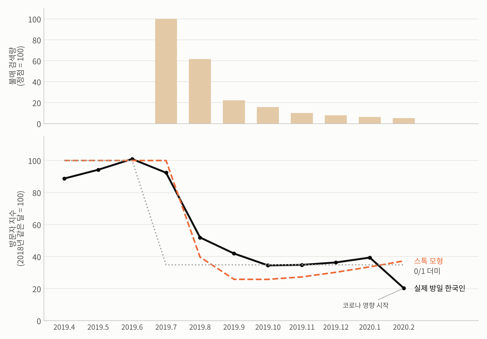
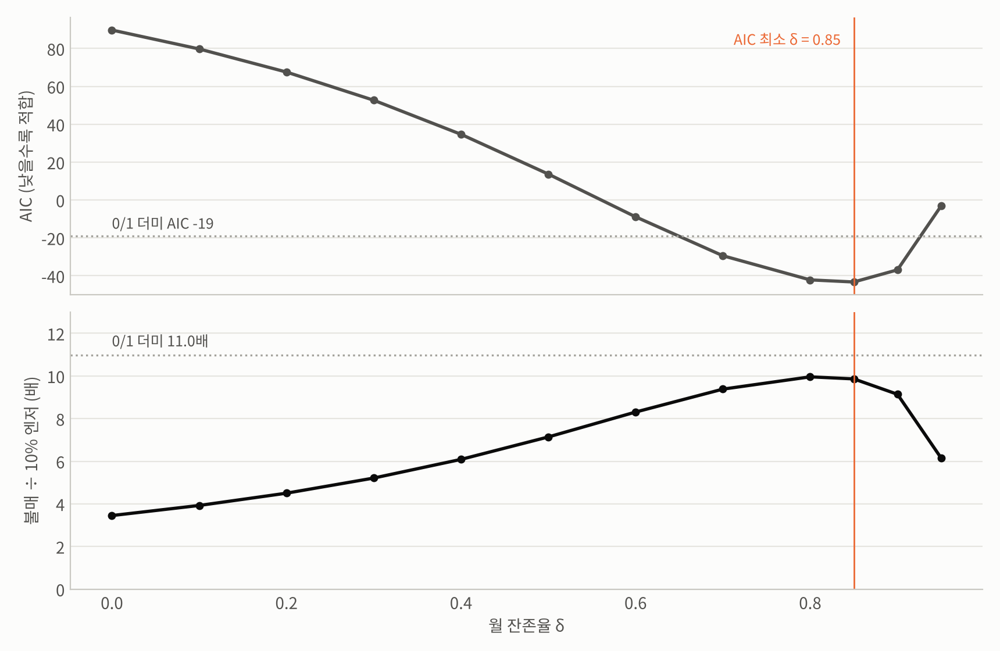
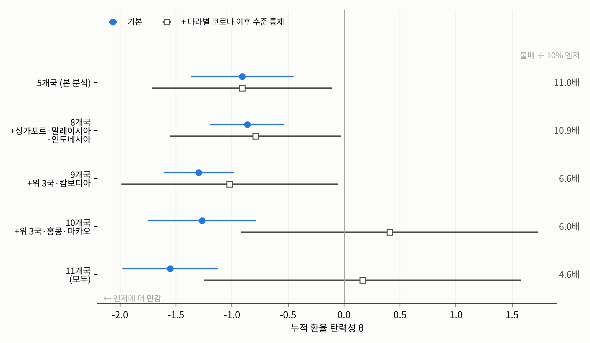
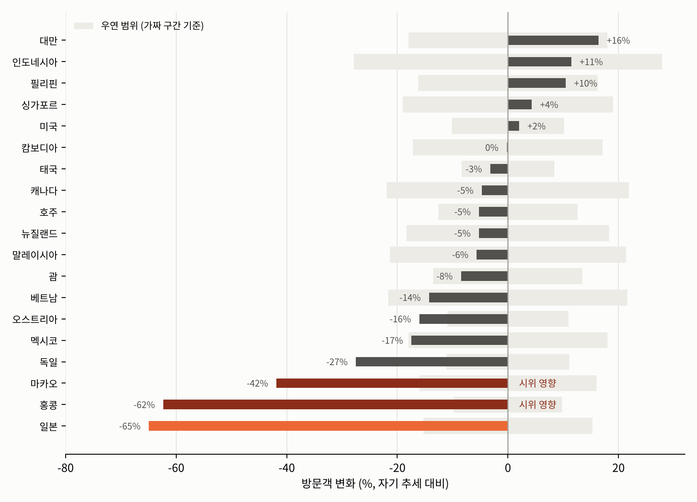
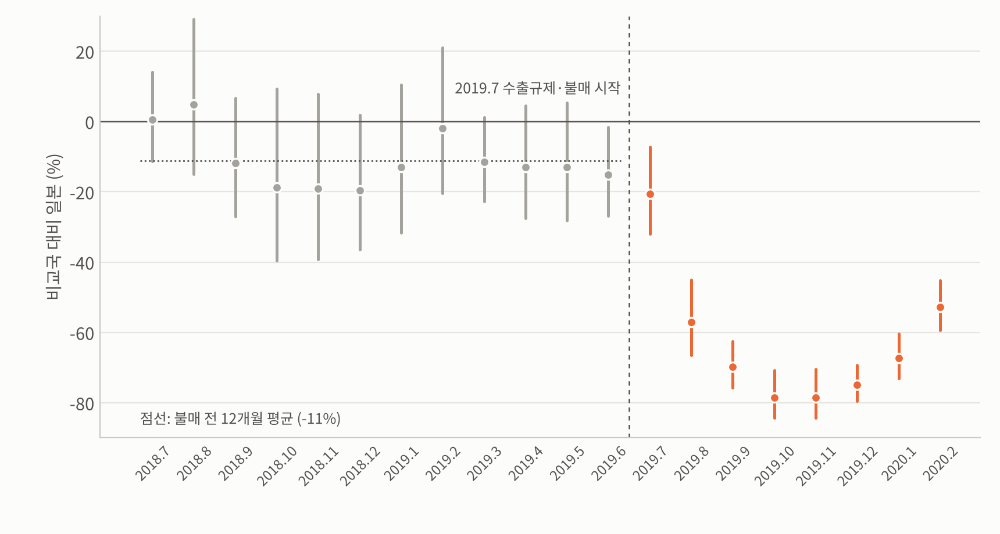
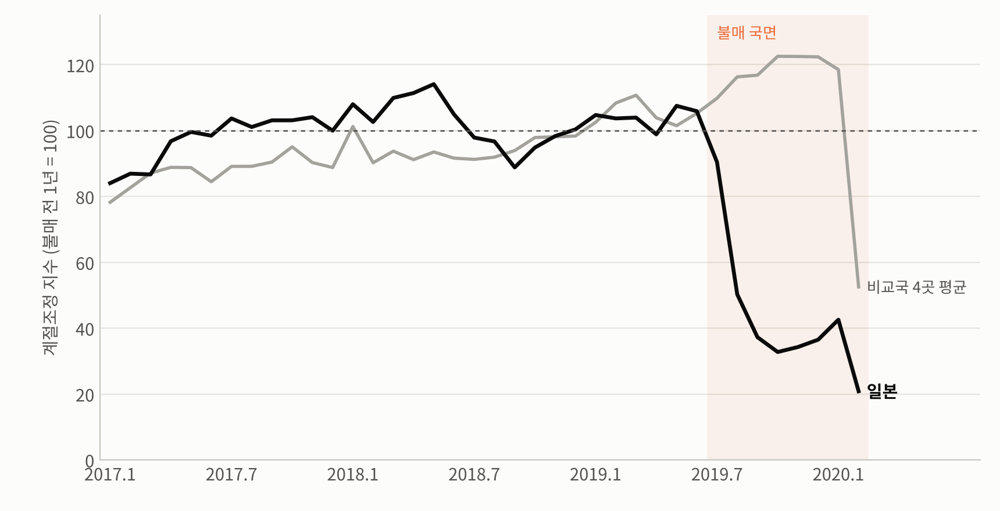
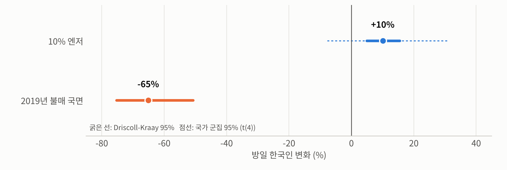

# 엔저와 불매 운동이 방일 한국인 수에 미치는 영향: 비교국 패널로 분리한 엔저 효과와 2019년 불매 충격

**비교국 대비 엔저(돈)와 2019년 불매 국면의 일본 고유 충격(마음)이 한국인의 일본 여행 수요에 미친 영향의 크기 비교**

2026 가천대학교 응용통계학과 학술제 출품작의 분석 코드와 결과 저장소예요. 원자료에서 패널을 만드는 단계부터 보고서에 들어가는 숫자와 그림까지, 스크립트 하나로 모두 재현돼요.

---

## 연구 질문과 흐름

| 단계 | 질문 | 스크립트 | 결과 |
|---|---|---|---|
| 1 | 엔저 효과는 얼마나 클까? (다른 나라와 공통인 여행 수요를 걷어낸 뒤) | `main_models.py` | `results/main_models.json`, 그림 1~3 |
| 2 | 불매운동 효과는 얼마나 컸고, 엔화가 얼마나 떨어져야 상쇄될까? | `money_vs_mind.py` | `results/money_vs_mind.json`, 그림 4 |
| 3 | 일본에서 빠진 수요는 다른 나라로 갔을까? | `demand_shift.py` | `results/share_shift_2019.csv`, 그림 5 |
| 4 | 이슈 없는 기간에 엔저 폭에 따라 효과가 달라질까? | `yen_tiers.py` | `results/yen_tiers.json`, 그림 6 |
| 5 | 선형 가정이 틀렸다면? 머신러닝(XGBoost)이 표본 밖 예측을 더 잘할까? | `xgb_robustness.py` | `results/xgb_oos_rolling.csv`, `results/xgb_robustness.json` |
| 6 | 불매의 강도는 얼마였고, 관심이 식은 뒤 얼마나 이어졌을까? (탐색적) | `boycott_stock.py` | `results/boycott_stock.json`, 그림 8a·8b |
| 7 | 비교국을 늘려도 같을까? 불매 기간에 미국·유럽 등으로 옮겨갔을까? | `comparison_expansion.py` | `results/comparison_expansion.csv`, `results/boycott_window_by_destination.csv`, 그림 9a·9b |
| 8 | 불매 직전 추세는 어땠나? 효과 크기 차이(D)·일본 고유 θ·2020.1~2 제외에도 같을까? | `review_checks.py`, `review_figures.py` | `results/review_checks.json`, 그림 10~12 |
| 9 | 이 결과는 여행사 대응에 무엇을 시사할까? (조건부 제안) | (1~8의 결과를 해석) | 보고서 |

## 핵심 결과

**한 줄 결론**: 공통 환율 탄력성을 일본에 적용하면 10% 상대 엔저의 수요 반응은 약 +10%, 2019년 불매 국면의 일본 방문 수요 변화는 약 −65%였어요. 점추정치 기준으로 불매 국면의 로그 효과는 10% 엔저 효과의 약 11배예요. 다만 엔저 효과는 국가 군집 추론에서 통계적으로 뚜렷하지 않았고(p = 0.19), 비율의 범위(DK 기준 6~24배)는 그 불확실성에 조건부예요. 분모 문제가 없는 로그 효과 크기 차이 D는 0.96(DK 95% 구간 0.61~1.31)이에요. '마음'은 소비자 심리뿐 아니라 당시 외교 갈등·보도가 겹친 일본 고유의 복합 충격이에요.

| 항목 | 추정치 | 의미 |
|---|---|---|
| 엔저 효과 (누적 환율 탄력성 θ, 본 분석) | **−0.91** (Driscoll-Kraay SE 0.23) | 비교국 통화 대비 엔화가 10% 싸지면 0~10개월에 걸쳐 방일 한국인 약 **+10%** |
| └ 비교국이 적을 때의 추론 | wild cluster bootstrap p = 0.19 | 국가가 5개뿐이라 국가 단위 불확실성까지 보면 5% 수준에서 유의하지 않음. 부호와 크기(+6~+17%)는 사양을 바꿔도 안정적 |
| 일본만 본 단순 모형 (통념) | −2.17 (SE 0.48) | 10% 엔저 → +26%. 엔저를 일본 여행 수요의 추세와 공통 충격(코로나 전 여행 붐, 코로나 후 보복 여행)과 구분하지 못해 부풀려짐. 코로나 이전 표본만 써도 −4.08 vs 패널 −1.21 |
| 불매운동 효과 (2019.7~2020.2 평균) | **−65%** (95% CI −75 ~ −51%) | 같은 시기 비교국 대비 감소. 가짜 불매 구간 35개 모두보다 커서 36개 중 1위(경험적 p = 1/36 ≈ 0.03, 이 검정의 최솟값), 분포 기준 약 13 표준편차 바깥 |
| 불매운동 정점 (2019.10~12) | −76% | |
| **불매 효과 ÷ 10% 엔저 효과** | **약 11배** (점추정치, DK 공분산 기준 모의실험 6 ~ 24배) | 로그 척도 비교. 환율계수를 크게 설정한 민감도(θ = −2.58, γ 고정)에서는 3.9배로, 통계적 하한은 아님 |
| 로그 효과 크기 차이 D = (−γ) − θ·ln0.9 | **0.96** (DK 95% 구간 0.61 ~ 1.31) | θ가 0 근처일 때 비율이 불안정해지는 문제를 피하는 보조 지표 |
| 불매 직전 1년 (일본 × 월, 2018.7~2019.6) | 평균 −11%, 12개 계수 = 0 가설 p = 0.14 | 기각하지 못함. 직전 1년 대비 불매 효과 −62%, 약 10배. 2018년 9~12월이 낮음(간사이공항 폐쇄·홋카이도 지진 시기) |
| 일본 고유 환율계수 허용 | θ_JP −1.15 (나머지 4개국 −1.27, 차이 SE 0.08) | 10% 엔저 +12.9%, 9.3배 |
| 2020년 1~2월 제외 (모든 나라) | 불매 −67%, 10% 엔저 +9.5% | 12.1배 |
| 머신러닝 예측 비교 (FWL 잔차 + rolling origin, 부록) | 표본 밖 100 × 로그 오차 RMSE: 선형 **47.3** vs XGBoost 51.7 | XGBoost의 예측 성능 개선을 확인하지 못함(Diebold-Mariano p = 0.36). 유의하지 않음은 동등성의 증명이 아니므로, 해석 가능성과 단순성을 이유로 선형을 기본 사양으로 유지. 같은 달 비교국 실적을 쓴 조건부 예측 |
| 불매 스톡 (네이버 검색량 adstock, 탐색적) | δ = 0.85, 스톡의 감쇠 반감기 약 4.3개월, 불매 ÷ 10% 엔저 **9.9배** | 0/1 더미보다 잘 맞음(AIC −43 vs −19, 불매 기간 로그 잔차 RMSE 0.11 vs 0.26). 반감기는 소비자 심리나 실제 수요 회복기간과 같다고 보지 않음. δ = 0.6~0.9에서 8.3 ~ 10.0배 |
| 비교국 확장 (+ 싱가포르·말레이시아·인도네시아, 8개국) | θ −0.86, 불매 −63%, **10.9배** | 크기 관계 같음, 국가 단위 추론의 p값은 0.19 → 0.08로 낮아짐. 홍콩·마카오·캄보디아는 불매 기간 자체 충격(홍콩 시위)과 코로나 이후 구조적 감소가 달러 강세와 겹쳐 비교국 조건을 어겨 제외 |
| 불매 기간 다른 권역 이동 (2019.7~2020.1, 자기 추세 대비) | 미국 +2%, 괌 −8%, 호주 −5%, 유럽 −8 ~ −27% | 모두 가짜 구간 범위 안이거나 감소. 추세보다 늘어난 곳을 다 더해도 약 32만 명(일본 감소 344만 명의 10% 미만) |
| 불매 충격 상쇄에 필요한 이론적 엔화 하락률 (보조 해석) | 약 69% (모의실험 95% CI 47 ~ 92%) | 불매 효과의 크기를 환율 단위로 바꾼 환산값. 관측된 최대 엔저(약 12%)의 약 6배라 예측이 아님 |
| 2019년 하반기 일본 감소 (추세 보정) | 약 −165만 명 | 늘어난 목적지만 합하면 약 70만 명(42%, 증가분이 모두 일본에서 옮겨왔다고 가정한 시나리오). 줄어든 곳(홍콩 −39만, 마카오 −12만)까지 합한 순증은 약 9만 명. 전체 출국자도 추세 대비 약 −137만 명이라 여행 취소·유보 가능성을 시사 |
| 2018 → 2024~25 일본 증가분 분해 | 실제 +19.2 (로그×100) | 공통 요인 +18.0, 엔저 +7.4(약 40%, θ × 엔화 변화), 일본 고유 −6.3. 개별 시차 계수로 계산하면 엔저 +4.5(24%) |
| 이슈 없는 기간 엔저 구간별 효과 | 0~5% 엔저 +18%, 5% 초과 +2% (기준: 2018년 대비 0~5% 엔고) | 일정 탄력성과 통계적으로 구분되지 않음. 5% 초과 구간은 일본 2016.1과 2023.9~2025.8의 25개월뿐이라 그 시기 일본 고유 요인과 구분 불가 → 가설 수준 |
| 오염수 방류 (2023.8.24 시작, 월별 분석은 2023.9~) | −13 ~ −18% (95% CI 약 −35 ~ +15%) | 효과가 없다고 할 수는 없지만, 불매 규모(−65%)는 신뢰구간 밖 |

## 데이터

| 자료 | 내용 | 파일 |
|---|---|---|
| 한국관광 데이터랩, 국민 해외관광객 주요 목적지별 통계 (2025.12 판) | 목적지 국가가 집계한 월별 한국인 입국자 수 | `data/raw/kto_outbound_by_destination_202512.xlsx` |
| 한국은행 ECOS, 주요국 통화의 대원화 환율 | 월평균 환율 (원/100엔, 원/대만달러, 원/바트, 원/페소, 원/100동) | `data/raw/ecos_fx_monthly_2015_2026.csv` |
| [네이버 데이터랩](https://datalab.naver.com/) 검색어 트렌드 | '노재팬', '일본 불매', '불매운동' 월별 상대 검색량 (한 번에 요청해 같은 척도) | `data/raw/naver_datalab_boycott_search.csv` |
| 유럽중앙은행(ECB) 유로 기준환율 | 싱가포르달러, 링깃, 루피아, 홍콩달러, 미국 달러의 원화 교차환율 (월평균, 비교국 확장용) | `data/raw/ecb_krw_cross_monthly.csv` (`src/fetch_ecb_fx.py`) |
| [JNTO 訪日外客統計](https://www.jnto.go.jp/statistics/data/visitors-statistics/) `訪日外客数（2003年～2026年）` | 일본 측 원자료. 엑셀 값 검증과 2025년 11~12월 확정치 대체에 사용 | 레포에 포함하지 않음 (링크에서 내려받기). 사용한 두 값은 `src/build_panel.py`에 출처와 함께 기록 |

- 분석 대상: 일본과 비교국 4곳(베트남·태국·필리핀·대만), 2016.01 ~ 2025.12 월별
- 자세한 출처, 변수 정의, 국가별 입국 재개 시점 기준은 [`data/README.md`](data/README.md)를 참고해 주세요.

## 방법 요약

**모형 2 (본 분석): 5개국 이원 고정효과 패널 회귀 + 분포시차**

```
ln V_ct = Σ_{k=0}^{10} β_k · ln FX_{c,t−k}  +  γ · 불매_ct
          + μ_{c,m}   (국가 × 달력 월 고정효과: 나라별 계절성)
          + λ_t       (연-월 고정효과: 코로나, 원화 전반의 강약, 한국인 해외여행 수요 전반 등 모든 나라 공통 요인)
          + ρ_e       (재개 후 경과 개월 고정효과: 재개 시점이 다른 나라들의 회복 곡선)
          + ε_ct
```

- **돈** θ = Σβ_k (누적 환율 탄력성), **마음** γ (불매운동 더미)
- θ는 연-월 고정효과가 원화 전반의 강약을 흡수하므로 **비교국 통화 대비 상대 환율 탄력성**이에요.
- **크기 비교**: −γ ÷ (θ · ln 0.9) = 불매 효과가 10% 엔저 효과의 몇 배인지(로그 척도). 로그 척도에서는 효과가 더해지므로 '10% 엔저를 몇 번 연달아 겪어야 불매 충격을 메우는가'라는 뜻이에요. 퍼센트끼리 나누면(65% ÷ 10%) 약 6.5배지만, 퍼센트 변화는 더해지지 않아 이런 뜻을 갖지 않아요.
- **로그 효과 크기 차이** D = (−γ) − θ · ln 0.9: 비율의 분모가 0에 가까워지는 문제를 피하는 보조 지표
- **불매 충격 상쇄에 필요한 이론적 엔화 하락률** d\*: θ · ln(1 − d\*) = −γ → **d\* = 1 − exp(−γ/θ)** (수익·비용 분석이 아닌 환산값)
- θ의 해석: 원/현지통화 환율이 1% 오를 때의 % 변화(엔화 1% 하락 효과는 −θ). 상대 환율이 낮아진 상태가 유지될 때 0~10개월 시차가 모두 반영된 효과이고, 10개월간 추가 방문객의 합이 아니에요. θ는 5개국 공통 탄력성을 일본에 적용한 값이에요(일본 고유 계수를 허용하면 −1.15).
- 표준오차: Driscoll-Kraay (Bartlett, 대역폭 3개월, 국가 간 상관과 시계열 자기상관에 강건; 코로나 폐쇄 전후 달은 커널에서 이웃 기간으로 취급), 모형 1은 Newey-West. 국가가 5개뿐이라 wild cluster bootstrap과 가짜 불매 구간 위약 검정을 함께 보고
- 시차 길이 K = 10: AIC 최소값. 다만 AIC가 평평해서 K = 0~12 결과를 모두 보고 (θ −0.87 ~ −1.17). 신뢰구간은 K = 10 선택 이후의 조건부 구간이에요
- 비교 대상 **모형 1 (통념)**: 일본만 사용, 환율 시차 + 불매 더미 + 월 더미

**검정과 진단**: 단위근(ADF/KPSS), 공적분(Engle-Granger), 잔차 자기상관(Ljung-Box), 계절성 F 검정, 미래 환율 위약 검정(선행 효과의 증거 없음, 다만 검정력이 낮음), 가짜 불매 구간 위약 검정, 비교국 오염 보정

**선형 가정 점검 (머신러닝 예측 비교)**: 모형 2의 고정효과를 방문자 수와 설명변수에서 먼저 걷어낸 뒤(Frisch-Waugh-Lovell) 잔차에 XGBoost를 적합해요. 식별은 그대로 두고 함수 형태만 유연하게 하는 방식이에요. 2018.6~2025.6 rolling origin으로 표본 밖 예측을 비교해요. 효과 크기는 반사실 값이 트리의 학습 범위 밖이라 XGBoost로 계산하지 않아요. 설계와 판정 기준은 결과 전에 [`docs/xgb_prereg.md`](docs/xgb_prereg.md)에 적었어요.

**불매 스톡**: 0/1 불매 더미 대신 검색량을 쌓아 가며 줄어드는 불매 심리 K_t = S_t + δ·K_{t−1}을 넣어요(S: '노재팬'+'일본 불매' 검색량에서 2021~2026 중앙값을 뺀 값, 한 달 시차). δ는 AIC로 고르고, δ에 따른 결과를 곡선으로 함께 보고해요. δ를 불매 한 번에 맞춘 값이라 본 결과는 0/1 더미로 유지해요.

**비교국 확장**: 싱가포르·말레이시아·인도네시아·홍콩·마카오·캄보디아를 차례로 더해 모형 2를 다시 추정해요. 좋은 비교국의 조건 세 가지(① 불매 기간에 자기만의 큰 충격이 없을 것, ② 일본에서 빠진 수요가 크게 옮겨오지 않을 것, ③ 환율 변동이 그 나라 고유의 구조 변화와 겹치지 않을 것)를 각각 데이터로 확인해요. 자세한 내용은 [`docs/methodology.md`](docs/methodology.md) 13장이에요.

**강건성**: 비교국 하나씩 제외, 다른 재개 시점 기준, 회복 전환기 제외, 국가별 추세 추가, 재개 직후 3개월 제외, 태국·필리핀 2025년 제외, 일본 2025년 하반기 제외, 전년동월비 모형, 코로나 이전 기간만. 엔화 10% 하락 효과는 +6 ~ +17% 범위이고, 대만을 뺄 때와 전년동월비 모형에서는 신뢰구간에 0이 들어가요. 이론적 엔화 하락률은 48 ~ 87% 범위예요. 불매 효과 쪽은 비교국 오염을 보정해도 −65% → −62%, 이론적 하락률 69% → 67%로 거의 그대로예요.

방법 설명 전체: [`docs/methodology.md`](docs/methodology.md)  
진단 표와 표준오차 민감도: [`results/diagnostics_appendix.md`](results/diagnostics_appendix.md)

## 그림

| | |
|---|---|
|  |  |
|  |  |
|  |  |
|  |  |
|  |  |
|  |  |
|  | |

그림에는 제목·출처를 넣지 않았어요. 보고서용 캡션과 각주 초안은 [`docs/figure_captions.md`](docs/figure_captions.md)에 있어요.

## 재현 방법

```bash
pip install -r requirements.txt
bash run_all.sh          # 약 3분 (XGBoost 부트스트랩 포함)
```

그림에 한글 글꼴이 필요해요. `src/figures.py`는 Noto Sans CJK를 먼저 찾고, 없으면 맑은 고딕, AppleGothic, 나눔고딕 순서로 찾아요.

## 폴더 구조

```
.
├── README.md
├── requirements.txt
├── run_all.sh                 전체 파이프라인 실행
├── data/
│   ├── README.md              출처, 변수 정의, 입국 재개 시점 표
│   ├── raw/                   원자료 (수정하지 않음)
│   └── processed/panel.csv    국가 × 월 패널 (build_panel.py 출력)
├── src/
│   ├── config.py              경로, 국가 목록, 추정 기간
│   ├── panel_models.py        모형 1·2, Driscoll-Kraay 표준오차, 손익분기 계산 (공용 함수)
│   ├── build_panel.py         1. 패널 구축
│   ├── main_models.py         2. 진단, 모형 1 vs 모형 2, 강건성, 증가분 분해
│   ├── money_vs_mind.py       3. 불매운동 효과, 이론적 엔화 하락률
│   ├── demand_shift.py        4. 2019년 목적지 비중 이동
│   ├── yen_tiers.py           5. 엔저 폭 구간별 효과
│   ├── lag_sensitivity.py     부록: 시차 길이 민감도
│   ├── diagnostics.py         부록: 시계열 진단, 표준오차 민감도 (tsdiag.py 사용)
│   ├── xgb_robustness.py      6. 선형 가정 점검: XGBoost 표본 밖 예측 비교
│   ├── spline_check.py        부록: 자연 스플라인 점검 (채택하지 않음)
│   ├── boycott_stock.py       7. 검색량 불매 스톡 (그림 8a·8b)
│   ├── comparison_expansion.py 8. 비교국 확장, 불매 기간 목적지별 변화 (그림 9a·9b)
│   ├── review_checks.py       9. 외부 검토 반영 점검: 표본 구성, D, 사전 추세, 일본 고유 θ, 2020.1~2 제외
│   ├── review_figures.py      그림 10~12
│   ├── fetch_ecb_fx.py        ECB 환율 파일 생성 (1회성)
│   └── figures.py             그림 1~6
├── results/                   분석 결과 (JSON, CSV)
├── figures/                   보고서용 그림 (PNG)
└── docs/
    ├── methodology.md         방법론 상세
    ├── strategy.md            국면별 여행사 전략 (결과 해석)
    ├── xgb_prereg.md          XGBoost 점검 사전 명시 (결과 전 작성)
    ├── spline_prereg.md       자연 스플라인 점검 사전 명시 (부록, 채택하지 않음)
    └── report_flow_explainer.md  보고서 흐름 해설과 검토
```

## 한계

- **비교국이 적어요**: 비교국 4곳(국가 5개)이라 국가 단위 군집 추론에서는 엔저 효과가 유의하지 않아요(p ≈ 0.19). 비교국 조건을 통과하는 동남아 3국을 더한 8개국에서는 p ≈ 0.08이고 결론은 같아요. 특히 일본과 같은 시기에 재개한 비교국이 대만 하나뿐이라, 코로나 이후 일본의 반사실은 대만에 크게 기대요(대만 제외 시 +6%, CI에 0 포함). 그래서 "엔저 효과가 정확히 +10%"보다 "환율계수를 크게 잡는 사양에서도 불매 국면의 효과가 더 컸다"로 말하는 게 정확해요. θ = −2.58을 넣은 3.9배는 두 추정량의 불확실성을 함께 반영한 통계적 하한이 아니에요.
- **인과 해석의 범위**: 연-월 고정효과와 재개 후 경과 고정효과로 공통 요인을 통제했지만, 일본에만 해당하는 관측되지 않은 요인(항공 노선 확대, 일본 콘텐츠 유행 등)은 남아 있어요.
- **외삽**: 이론적 하락률 69%는 관측된 엔저 폭(최대 약 12%)의 약 6배라, 예측이 아니라 크기 비교용 환산값이에요. 12%를 넘는 값은 모두 관측 범위 밖이에요.
- **명목 환율**: 여행 비용은 일본 현지 물가와 원화 항공권 가격에도 달려 있어요. 일본의 상대 물가가 오른 시기에는 명목 엔저가 실제로 싸진 폭을 부풀리고, 실질 기준 탄력성은 θ보다 클 수 있어요. 그러면 배수는 작아져요.
- **불매 직전 추세**: 2018.7~2019.6 일본은 비교국 대비 평균 −11%였어요(12개 계수 = 0 가설 p = 0.14). 이 기준으로 재면 불매 효과는 −62%, 약 10배예요.
- **엔저 5% 초과 구간**은 일본에서만 25개월(2016.1, 2023.9~2025.8) 관측돼 그 시기 일본 고유 요인과 구분되지 않아요. 구간별 효과는 탐색적 분석이에요.
- **불매 효과의 표준오차**: 처치 단위가 일본 하나라 Driscoll-Kraay 표준오차가 작게 잡히는 경향이 있어요(가짜 구간의 14%가 |z| > 1.96). 대신 가짜 구간 분포와 비교하면 실제 효과는 약 13 표준편차 바깥이에요.
- **불매 사건이 하나뿐이에요**: 불매 효과, 불매 스톡의 δ(감쇠 반감기 약 4.3개월, 심리·수요 회복기간과 동일시하지 않음)는 모두 2019년 한 번에서 나온 값이라 다른 이슈에 그대로 통하는지는 검증할 수 없어요.
- **XGBoost는 예측 비교에만 써요**: 사전 명시한 효과 크기 기준(기준 2)은 불매 달이 트리의 학습 범위 끝에 있어 믿기 어렵다고 판단해 보고에서 뺐어요. 경위와 계산 결과는 [`docs/xgb_prereg.md`](docs/xgb_prereg.md)와 `results/xgb_robustness.json`에 그대로 남겼어요.
- **탐색적 선택**: 불매 정점(10~12월), 오염수 구간 2개, 엔저 구간 경계는 결과를 보고 정한 부분이 있어요.
- 목적지 국가 집계 기준이라 국적, 체류 목적 정의가 나라마다 조금씩 달라요.

## 참고문헌

- Ahn, J., Greaney, T. M., & Kiyota, K. (2022). Political conflict and angry consumers: Evaluating the regional impacts of a consumer boycott on travel services trade. *Journal of the Japanese and International Economies*, 65, 101216. https://doi.org/10.1016/j.jjie.2022.101216

## 관련 문서

- [`docs/report_flow_explainer.md`](docs/report_flow_explainer.md): 처음 보는 사람을 위한 분석 흐름 해설, 방법별 선택 근거, 오류·약점 검토
- 연구 설계 문서, 상세 분석 명세 (Claude Docs)
- Notion `2026 학술제` › 타임라인
